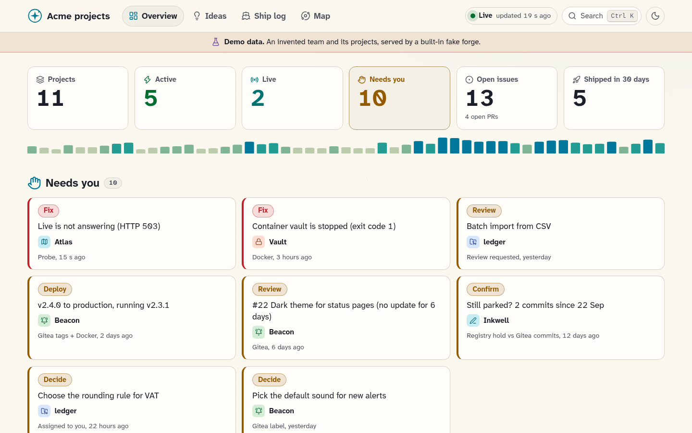
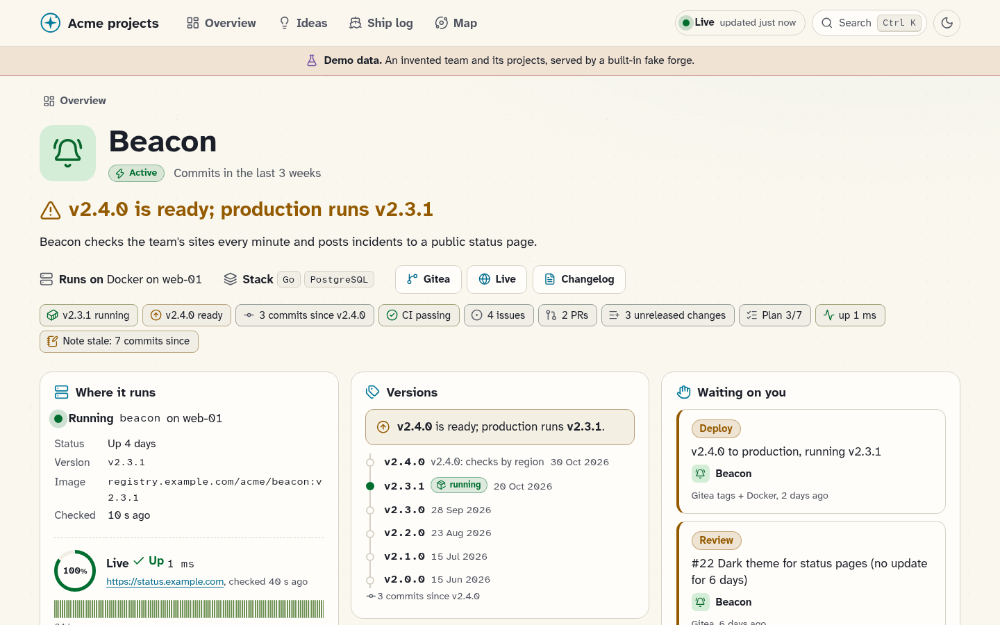
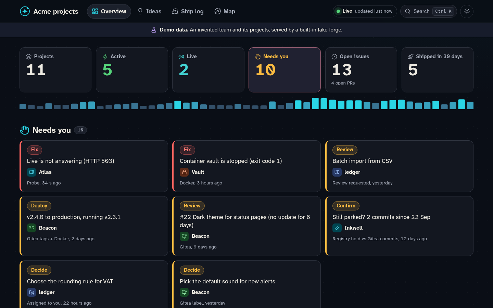
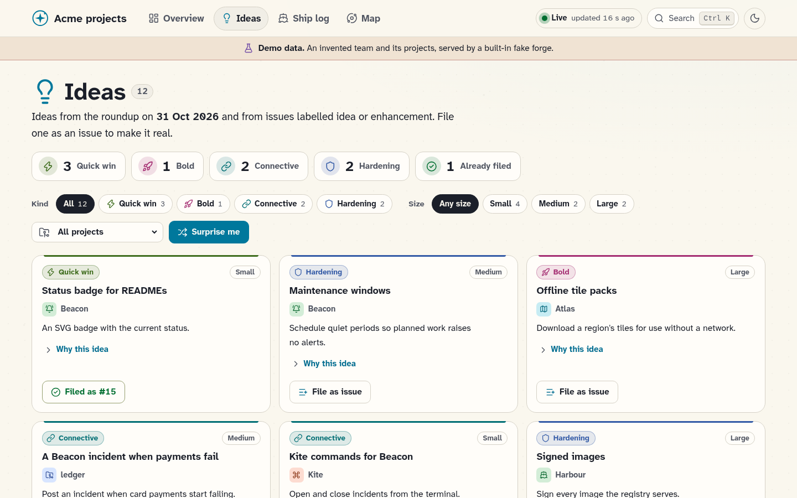
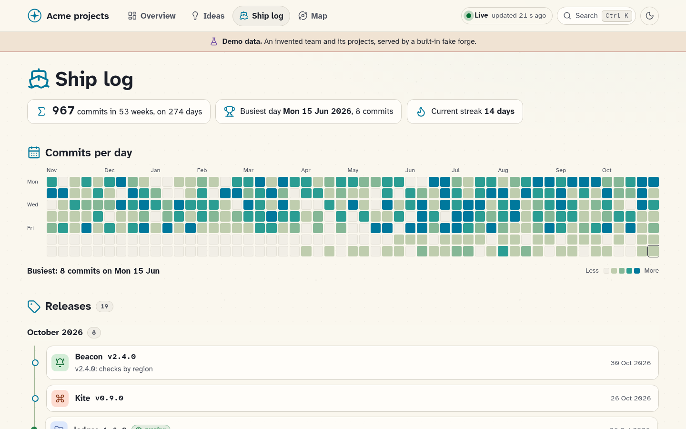
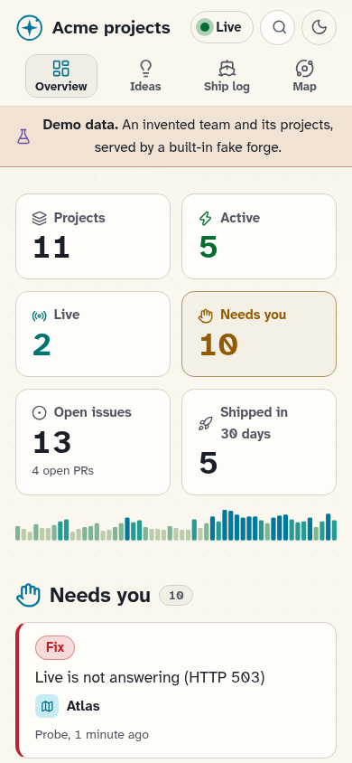

# Waymark

Waymark is a live status page for every project on your Gitea, Forgejo and
GitHub accounts. Give it a read-only token and it shows each project's state
(active, live, quiet, on hold), what is waiting on you, versions and deploys,
CI, issues, plans in progress, a ship log and a map. Nothing on the page is
typed in by hand: every state comes from the forges, and optionally from a
Docker host, HTTP probes, F-Droid and a notes folder. It needs no LLM and no
database, and it never writes to a forge.



## Privacy first

**There is no login.** Anyone who can reach the page sees everything it
shows. The JSON API (`/api/site.json`, `/api/p/...`, `/api/search.json`,
`/api/live.json`), the live stream (`/events`) and `/healthz` serve the same
data. All of it:

- **Repos:** names and links (which show your forge's address);
  descriptions, default branches, stars, open issue and PR counts, archived
  and mirror flags, tags and their dates. **Private repos** only when you
  turn them on (`include_private: true`); they are off by default.
- **Issues and PRs:** titles, numbers, labels and their colours, authors,
  comment counts and dates (up to 10 open issues and 10 open PRs per
  project, and 10 of its mirror's issues), and the titles of those that wait
  on you.
- **Commits:** the first line of each recent commit message, its author
  name, SHA and date; weekly commit counts; a year of daily contribution
  counts of the token users (the heatmap), which count all their activity,
  private repos included whatever `include_private` says (numbers only, no
  repo names).
- **CI:** run titles, branches, workflow names, state and times.
- **Releases:** tag names and release titles (not release notes), with
  dates.
- **Files read from repos:** the `CHANGELOG.md` Unreleased items and last
  version; plan file paths, titles and checkbox progress.
- **The projects file:** every project's name, summary, description, stack,
  "runs on" text, categories, holds and their reasons, relations, links, and
  each `urls:` link **and probe URL**, which can name internal hosts.
- **Probes:** each URL's state, HTTP code, latency and 24-hour history, and
  each repo homepage probed.
- **Docker**, when set up: container names, image names (with their
  registry), versions, states and Docker's status text, and the host label.
- **F-Droid**, when set up: the published version.
- **Notes**, when set up: file names, names, descriptions, index lines and
  each markdown note's text.
- **Ideas:** titles, pitches, reasons, and links to issues.
- **Events** for 14 days (releases, deploys, containers, CI, commits,
  issues, probes, notes and tier changes), and **source errors**, which can
  name file paths, hosts and the repos the projects file names.

Anyone who can reach it can also ask for a refresh (at most one every 20
seconds), which only reads again (on GitHub, only what changed).

Put it behind a reverse proxy that asks for a login (basic auth, or an
OAuth or forward-auth proxy), or keep it on your LAN or VPN. Publish the
port on loopback (`-p 127.0.0.1:8080:8080`) unless something in front of it
guards it.

- **Private repos are left out by default** (`include_private: false`):
  from projects, needs-you, ideas, events, the ship log and the map. A repo
  shows only once it is known to be public, so while a forge has not
  answered, a project or mirror from the projects file whose privacy is
  unknown stays hidden. To show private repos, set `include_private: true`
  (or `WAYMARK_INCLUDE_PRIVATE=true` without a file): then everything above
  shows for them too, to anyone who can reach the page, so only behind a
  login.
- **Tokens need only read access** (see [the scopes](#tokens-and-scopes)),
  and are never shown: not in pages, logs, errors or `/api/site.json`.
  Every forge call is a read.
- A GitHub forge **without a token** cannot tell that a repo the projects
  file names is private (GitHub answers 404 to anonymous reads), so such a
  project shows only what the projects file says about it, and a mirror
  it names on that forge is linked as named.
- Homepage probes (each repo's website field, `probes.homepages`) refuse
  loopback, private (RFC 1918, IPv6 ULA), link-local, CGNAT (100.64.0.0/10),
  unspecified (0.0.0.0/8, `::`) and multicast addresses (IPv4, IPv6 or
  IPv4-mapped), checked after DNS, and do not use `HTTP_PROXY` or
  `HTTPS_PROXY`: anyone who can edit a repo can set its website. The
  projects file's `urls:` are yours, and are probed as given.

## Quick start

### Try the demo

An invented team's projects from a built-in fake forge: no token, no config,
no network.

```bash
docker run --rm -p 127.0.0.1:8080:8080 ghcr.io/will-luck/waymark -demo
```

Open http://127.0.0.1:8080. Every page says it is demo data.

| | |
|---|---|
|  |  |
|  |  |



### GitHub only

```bash
docker run -d --name waymark --restart unless-stopped \
  -p 127.0.0.1:8080:8080 \
  -e GITHUB_TOKEN=github_pat_... \
  -e GITHUB_OWNERS=your-user,your-org \
  -e TZ=Europe/Paris \
  -v waymark-data:/data \
  ghcr.io/will-luck/waymark:latest
```

Each public repo of the listed owners becomes a project. Leave
`GITHUB_OWNERS` out to track only the token user's own repos; list orgs or
other users to track theirs.

Private repos stay off. To show them, add `-e WAYMARK_INCLUDE_PRIVATE=true`:
their names, issues, commits and CI then show to anyone who can reach the
page, so put a login in front of it first ([privacy](#privacy-first)).

### Gitea or Forgejo only

```bash
docker run -d --name waymark --restart unless-stopped \
  -p 127.0.0.1:8080:8080 \
  -e GITEA_URL=https://git.example.com \
  -e GITEA_TOKEN=... \
  -e GITEA_OWNERS=your-user,your-org \
  -v waymark-data:/data \
  ghcr.io/will-luck/waymark:latest
```

The same rule: leave `GITEA_OWNERS` out to track only the token user's own
repos (not repos you collaborate on, nor your orgs' repos); list orgs or
other users to track theirs. Gitea and Forgejo need the token; without one
their API refuses the list. Private repos stay off here too:
`-e WAYMARK_INCLUDE_PRIVATE=true` shows them, behind a login.

### Both

Set both sets of variables, or write a config file. A repo with the same
name on both forges becomes one project: the first forge holds the primary
(tags, releases, CI, plans), the second is a mirror (stars, its issues, its
latest release).

```yaml
# config/waymark.yml
site:
  title: Team status
  timezone: Europe/Paris
include_private: false   # true shows private repos: only behind a login
forges:
  - id: gitea
    type: gitea          # or forgejo
    url: https://git.example.com
    token: ${GITEA_TOKEN}
    owners: [acme]
  - id: github
    type: github
    token: ${GITHUB_TOKEN}
    owners: [acme]
    heatmap: false       # the mirrored commits are already counted on Gitea
```

```bash
docker run -d --name waymark --restart unless-stopped \
  -p 127.0.0.1:8080:8080 \
  -e GITEA_TOKEN=... -e GITHUB_TOKEN=... \
  -v "$PWD/config:/config:ro" \
  -v waymark-data:/data \
  ghcr.io/will-luck/waymark:latest
```

Images: `ghcr.io/will-luck/waymark` and `willluck/waymark` on Docker Hub,
for amd64 and arm64. Binaries for Linux (amd64, arm64, armv7) and macOS are
on the [releases page](https://github.com/Will-Luck/waymark/releases); run
`waymark` with the same variables and `DATA_DIR` set to a folder it can
write, or `waymark -demo`.

## Configuration

One YAML file, `/config/waymark.yml` (`WAYMARK_CONFIG` names another path),
with `${VAR}` expansion so tokens stay in the environment. Every key, its
default and an example are in [docs/configuration.md](docs/configuration.md);
[waymark.example.yml](waymark.example.yml) is a complete file to copy.

| Section | What it sets |
|---|---|
| [`site`](docs/configuration.md#site) | Page title, time zone, the names notes use for you |
| [`include_private`](docs/configuration.md#include_private) | Whether private repos show at all (off by default) |
| [`forges`](docs/configuration.md#forges) | Each Gitea, Forgejo or GitHub account: URL, token, owners, heatmap |
| [`projects`](docs/configuration.md#projects) | An optional [projects file](docs/configuration.md#the-projects-file): names, categories, grouped repos, containers, URLs to probe, holds, relations |
| [`ideas`](docs/configuration.md#ideas) | Idea labels, an optional [ideas file](docs/configuration.md#the-ideas-file), the filed-idea marker |
| [`needs_you`](docs/configuration.md#needs_you) | Which labels, assignments and review requests wait on you |
| [`notes`](docs/configuration.md#notes) | An optional notes folder |
| [`plans`](docs/configuration.md#plans) | Where plan files live in each repo |
| [`docker`](docs/configuration.md#docker) | A feed file or the Docker Engine API |
| [`probes`](docs/configuration.md#probes) | Whether repo homepages are probed |
| [`listen`, `data_dir`](docs/configuration.md#listen-and-data_dir) | Address and state directory |

Without a file, the [environment variables](docs/configuration.md#environment-variables)
above make an env-only setup.

## Tokens and scopes

Waymark only reads. Give it a token that can only read.

**Gitea and Forgejo:** an access token (Settings, Applications) with
`read:repository`, `read:issue`, `read:user` and `read:organization`. A
token is required: without one the API answers 401 and the forge's source
shows as failing.

**GitHub:** a fine-grained token with read-only **Metadata**, **Contents**,
**Issues**, **Pull requests** and **Actions** on the repos to track (choose
"All repositories" to pick up new ones). A classic token needs `repo` for
private repos, and no scopes at all for public ones.

What needs a GitHub token:

- listing an owner's repos (without one, only repos the projects file names
  are read);
- full detail: tags, commits, PRs, CI runs, the changelog and plans;
- the contribution calendar for the ship log, and the search that finds
  issues filed from ideas;
- anything private.

Without a token GitHub allows 60 requests an hour, so a tokenless forge reads
each named repo lightly: the repo, its open issues and its latest release,
every 30 minutes. With a token the limit is 5,000 an hour, and every read is
conditional (ETags), so unchanged data costs little. A spent limit is named
in the forge's status with the time it resets, and the forge is asked
nothing until then.

## Docker

- **Image:** Alpine, runs as uid 1000, listens on `8080`, no `HEALTHCHECK`
  (`GET /healthz` answers with each source's state if you want one).
- **`/data`** is a volume: `state.json` (events for 90 days, probe history)
  and the last good projects and ideas files. Use a named volume, or a
  directory uid 1000 can write.
- **`/config`** is where `waymark.yml` is read from. Bind-mount the
  directory, read-only.
- **Tokens** come in as `-e` variables and are named in the file as
  `${GITHUB_TOKEN}`.

Containers are optional. With one of these set, "Where it runs" shows each
project's containers, their state and running version, and the Deploy rule
compares that version with the newest tag:

| Setting | How | Notes |
|---|---|---|
| none | | Nothing about containers is shown |
| `docker.feed` | A host cron runs [`scripts/docker-feed.sh`](scripts/docker-feed.sh) every minute; mount its directory read-only at `/feed` | No Docker socket in the container. The safe default |
| `docker.host` | The Engine API: `tcp://socket-proxy:2375` or `unix:///var/run/docker.sock` | Prefer a socket proxy that allows only container listing. A mounted socket gives control of Docker even with `:ro`, and needs `--group-add` with the socket's group |

A container belongs to a project when the projects file lists it, when it is
named like the project's slug, or when its `org.opencontainers.image.source`
label is one of the project's repo pages.

## Notes adapters

Notes are optional (`notes.type: none`). Mount the folder read-only.

- **`markdown`:** any folder of `.md` files, such as an Obsidian vault. A
  file belongs to a project by its name (`<slug>.md`) or by front matter
  `project: <slug>`. A list item with a marker (`WAITING:` or `@me` by
  default) is a **Decide** item. The note's body shows in the project's
  Notes panel, and its age from front matter `updated:` or the file's time.
- **`claude-memory`:** for a Claude Code memory folder: a `MEMORY.md` index
  and one file per note. A clause that waits on one of your names in
  `site.you` ("awaits Mark", "needs Mark", "Mark's decision") is a
  **Decide** item. The panel is called "Claude's notes". Most people want
  `markdown` or `none`.

## Needs you

The overview's **Needs you** list, and each project's "Waiting on you":

| Verb | When |
|---|---|
| **Fix** | A project's main container is stopped, or one the projects file names is missing; a `urls:` probe from the projects file is down |
| **Deploy** | The running container's version (or the F-Droid build's) is older than the newest version tag |
| **Review** | An open PR, not a draft, with no update for 2 days; a PR that asks for your review (`needs_you.review_requests`) |
| **Confirm** | A project on hold has commits since the hold began: still parked? |
| **Decide** | An open issue or PR with a `needs_you.labels` label (`needs-you`, `decision`); one assigned to you (`needs_you.assigned`); a notes item |

"You" on each forge is the token's user. So the way to flag something as
waiting on you, with no notes at all, is to label it or assign it to
yourself. Failing CI shows on the project's card and page, not in the list.

## Ideas

Open issues labelled `idea` or `enhancement` (`ideas.labels`) are ideas,
on the **Ideas** page and each project's page, with kind and size from
`kind/*` and `size/*` labels. An optional ideas file holds ideas that are not
issues yet; each has **File as issue**, a filled-in new-issue link whose
last line is the `ideas.marker` and the idea's id, so once filed the idea
links its issue. The Ideas page and its link hide when there are none.

## Plans

Waymark reads dated plan files from each primary repo (`plans.dirs`, by
default `docs/plans` and `docs/superpowers/plans`): Markdown files named
`2026-10-28-new-editor.md`, or dated folders with a `plan.md`. A plan with
some, but not all, of its checkboxes ticked shows under "Next up" as "3 of
7", for up to 120 days from its date. A Keep a Changelog `CHANGELOG.md` adds its Unreleased items.

## FAQ and limits

- **Does it write anything to my forges?** No. Every call is a read.
- **What does it store?** Only `/data/state.json` and the last good copies
  of the projects and ideas files.
- **GitLab, Bitbucket, several Docker hosts, sign-in, notifications?** Not
  in this version.
- **Label ideas** come from each repo's 10 newest open issues, the ones
  Waymark already reads. On a busy repo an older labelled issue does not
  show.
- **Quote the ideas marker** in YAML: `marker: "waymark-idea:"`. An
  unquoted value ending in `:` fails to load.
- **`${VAR}` expands only in string fields.** `heatmap: ${H}` fails to load,
  and in flow style quote the value: `{token: "${T}"}`.
- **Notes markers** right after Markdown punctuation (`**@me**`, `(@me)`)
  do not match.
- **Notes symlinks** that leave the notes folder, and absolute symlinks, are
  not followed. Files over 1 MiB are skipped.
- **Plans** need a date at the start of the file or folder name.

## Licence

MIT. Made by Will Luck. See [LICENSE](LICENSE).
