# Waymark

A **self-hosted**, read-only page that shows every project on your Gitea,
Forgejo and GitHub accounts: what is active, what is deployed, and what waits
on you.

[](https://github.com/Will-Luck/waymark/releases)
[](LICENSE)
[](https://github.com/Will-Luck/waymark/pkgs/container/waymark)

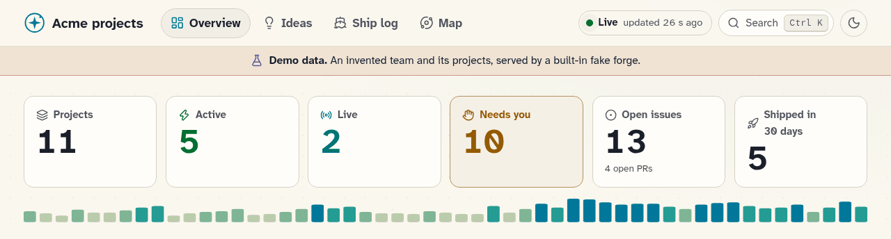

> - **There is no login:** anyone who can reach the page sees everything it
>   shows, and its JSON API serves the same data.
> - **Shown to them:** repo names, issue and PR titles, commit messages and
>   source errors; if set up, also container names, probe URLs and note text.
> - **Private repos are hidden** by default; show them only behind a login.
> - **Keep it private:** put Waymark behind a reverse proxy that asks for a
>   login, or keep it on your LAN or VPN. See [Privacy](https://github.com/Will-Luck/waymark/wiki/Privacy-and-Security)
>   for everything it shows.

## Try it in one command

```bash
docker run --rm \
  -p 127.0.0.1:8080:8080 \
  ghcr.io/will-luck/waymark -demo
```

Open http://127.0.0.1:8080 to see an invented team's projects from a
built-in fake forge: no token, no config, no network, and every page says it
is demo data.

## A quick tour

The header has four tabs: **Overview**, **Ideas**, **Ship log** and **Map**.

| Page | Where | Answers |
|---|---|---|
| [Overview](#overview) | Tab | What is going on? |
| [Needs you](#needs-you) | On the Overview | What do I need to do? |
| [Project page](#project-page) | Open any project | Is it deployed and healthy? |
| [Ideas](#ideas) | Tab | What could we do next? |
| [Ship log](#ship-log) | Tab | What have we shipped? |
| [Map](#map) | Tab | How do projects relate? |

### Overview

**Every project at a glance:** count tiles, a year of commits, what changed
since you last looked, and every project grouped by state.

The six states are Active, Live, On hold, Quiet, Dormant and Archived. The
page updates itself, and the header says **Live** or names a failing source.

Further down the Overview, every project is grouped by state, starting with
Active:

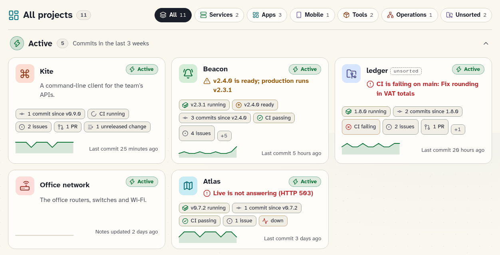

### Needs you

**What is waiting on you:** things to Fix, Deploy, Review, Confirm or
Decide, each naming its project and where it came from.

Cards come from your forges, Docker, probes, F-Droid, the projects file and
notes. On a forge, "you" is the token's user: to add a card, label an issue
`needs-you` or assign it to yourself.

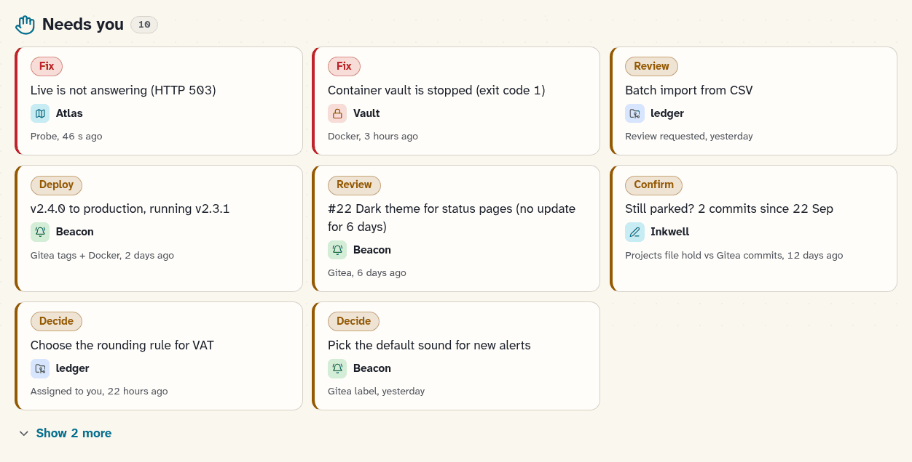

### Project page

**Everything about one project:** is it deployed, is it healthy, what is
left. You can tell without opening the forge.

**The top:** its state and why, then chips for versions, CI, issues, PRs and
plan progress.

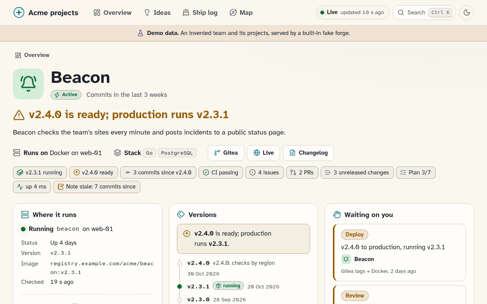

**Further down:** where it runs, and its versions with the running one
marked.

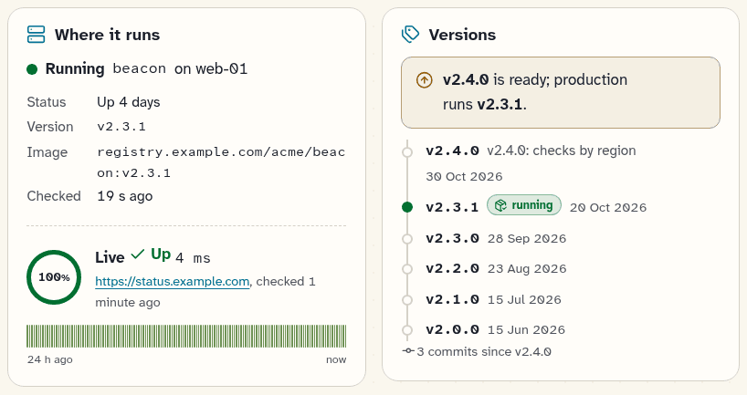

### Ideas

**Feature ideas** from issues labelled `idea` or `enhancement`, and from an
optional ideas file. Filter them by kind and size, or press **Surprise me**.

An idea that is not an issue yet has a **File as issue** button. With no
ideas set up, the page stays hidden.

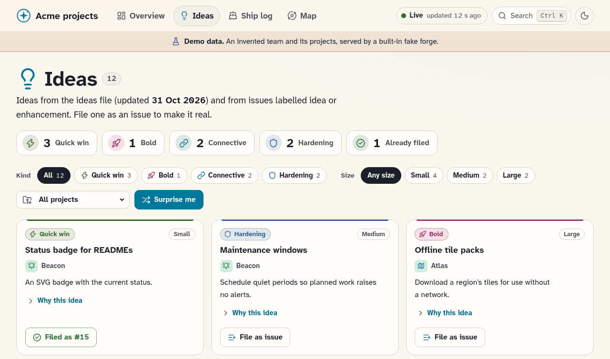

### Ship log

**A year of commits per day**, your busiest day and current streak, then
every release of the last 18 months, by month.

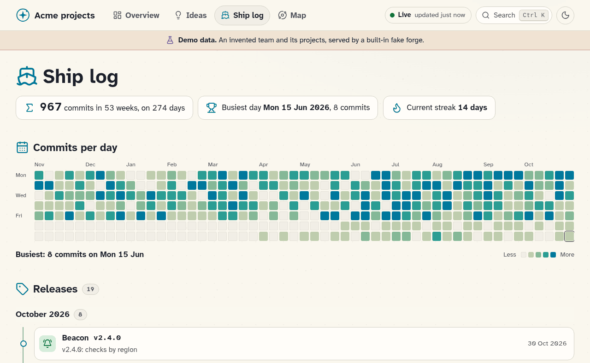

### Map

**Every project as a star**, grouped by category. Colour shows the state,
size shows the last 12 weeks of commits, and lines join related projects.

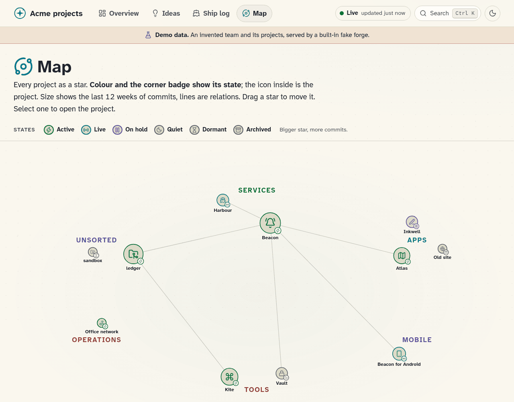

### Search

Press **Ctrl K** (Cmd K on a Mac, or **/**) and type a few letters to jump to
any project, idea or issue.

It also runs commands: **Refresh now**, **Toggle theme** and **Surprise me**.

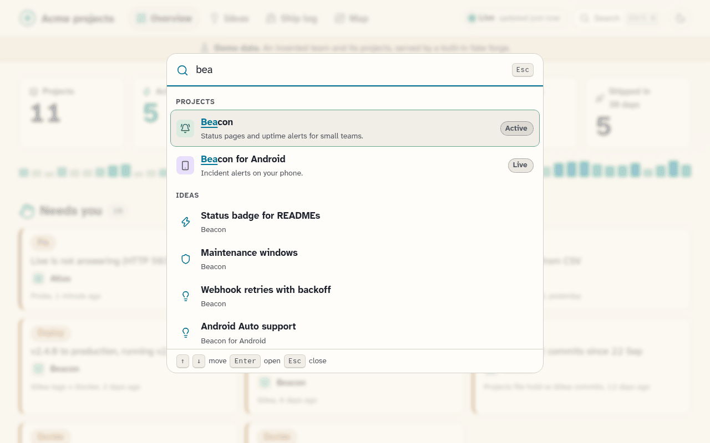

### Dark mode and phone

**Light or dark:** it follows your system until you press the sun or moon
button. Every page also fits a **phone**.

| Dark theme | On a phone |
|---|---|
| 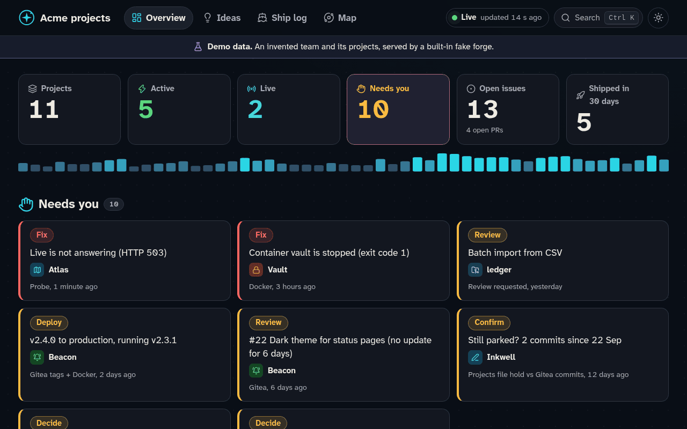 | 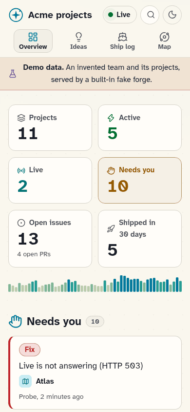 |

## What it reads

Nothing on the page is typed in by hand: every state comes from these
sources. Waymark needs no LLM and no database, and it **only reads**: it
never writes to a forge and never shows your token.

| Source | What it adds | Needed? |
|---|---|---|
| **Forges** (Gitea, Forgejo, GitHub) | Projects, versions, CI, issues, PRs, commits, plans, ideas | **Yes** |
| **Projects file** | Names, categories, grouped repos, holds, relations, URLs to probe | No |
| **Notes** folder | A notes panel on each project, and Decide items | No |
| **Docker** | Where each project runs, and its running version | No |
| **Probes** | Up or down, latency and 24-hour history for each URL | No |
| **F-Droid** | The published version of an Android app | No |

You need **at least one forge**. Without a projects file, each repo is a
project. Repo homepages are probed by default.

Every setting is in the [Configuration Reference](https://github.com/Will-Luck/waymark/wiki/Configuration-Reference).

## Install

Each command publishes the port on `127.0.0.1` only. Read the no-login note
above before you open it up.

**GitHub only:** give it a read-only token and the owners to track, and each
of their public repos becomes a project.

<details>
<summary>Show the command</summary>

```bash
docker run -d --name waymark --restart unless-stopped \
  -p 127.0.0.1:8080:8080 \
  -e GITHUB_TOKEN=github_pat_... \
  -e GITHUB_OWNERS=your-user,your-org \
  -e TZ=Europe/Paris \
  -v waymark-data:/data \
  ghcr.io/will-luck/waymark:latest
```

</details>

**Gitea or Forgejo only:** give it your forge's address, a read-only token
and the owners to track.

<details>
<summary>Show the command</summary>

```bash
docker run -d --name waymark --restart unless-stopped \
  -p 127.0.0.1:8080:8080 \
  -e GITEA_URL=https://git.example.com \
  -e GITEA_TOKEN=... \
  -e GITEA_OWNERS=your-user,your-org \
  -v waymark-data:/data \
  ghcr.io/will-luck/waymark:latest
```

</details>

**Both:** set both sets of variables or write a config file, and a repo with
the same name on both forges becomes one project.

<details>
<summary>Show the config file and the command</summary>

```yaml
# config/waymark.yml
site:
  title: Team status
  timezone: Europe/Paris
include_private: false   # true shows private repos: only behind a login
forges:
  - id: gitea
    type: gitea          # or forgejo
    url: https://git.example.com
    token: ${GITEA_TOKEN}
    owners: [acme]
  - id: github
    type: github
    token: ${GITHUB_TOKEN}
    owners: [acme]
    heatmap: false       # the mirrored commits are already counted on Gitea
```

```bash
docker run -d --name waymark --restart unless-stopped \
  -p 127.0.0.1:8080:8080 \
  -e GITEA_TOKEN=... -e GITHUB_TOKEN=... \
  -v "$PWD/config:/config:ro" \
  -v waymark-data:/data \
  ghcr.io/will-luck/waymark:latest
```

</details>

Token scopes, private repos, Docker options, images and binaries are in the
[install guide](https://github.com/Will-Luck/waymark/wiki/Installation).

## Documentation

| Page | What is in it |
|---|---|
| [Install](https://github.com/Will-Luck/waymark/wiki/Installation) | Each setup in full, token scopes, Docker, images and binaries |
| [Privacy](https://github.com/Will-Luck/waymark/wiki/Privacy-and-Security) | Everything the page shows, and how to keep it private |
| [Features](https://github.com/Will-Luck/waymark/wiki/Features) | States, the Needs you rules, notes, ideas, plans and containers |
| [FAQ](https://github.com/Will-Luck/waymark/wiki/FAQ-and-Known-Limits) | Common questions and known limits |
| [Configuration](https://github.com/Will-Luck/waymark/wiki/Configuration-Reference) | Every setting, its default and an example |
| [Changelog](CHANGELOG.md) | What changed in each release |

## About

Waymark started as a status page I built for my own homelab, to see all of
my projects in one place. I adapted it so anyone with Gitea, Forgejo or
GitHub can run it, in case others find it useful too.

## Licence

MIT. Made by Will Luck. See [LICENSE](LICENSE).
